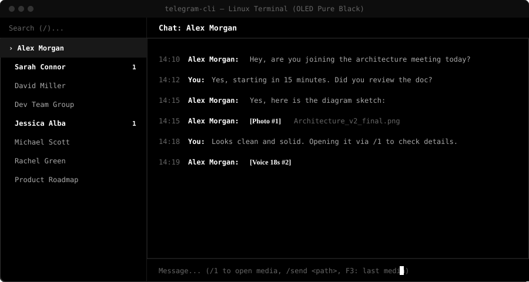
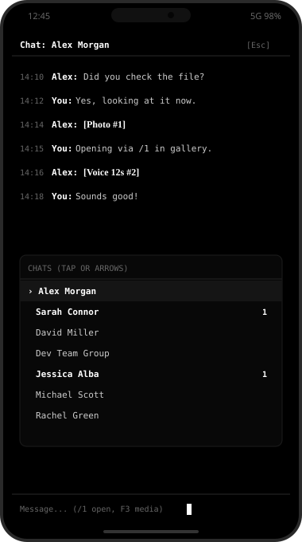

# 🖤 Minimalist Telegram CLI (OLED & Dopamine-Free)

A clean, distraction-free, and keyboard-driven **Terminal User Interface (TUI)** client for Telegram. Designed for digital minimalism, low dopamine consumption, and maximum focus across **macOS**, **Linux Desktop**, and **Android (Termux)**.

---

## 📸 Preview

### 💻 Desktop Terminal (macOS / Linux)


### 📱 Android Mobile (Termux / OneUI)
<p align="center">
  
</p>

---

## ✨ Features

- **🖤 OLED Pure Black:** True black (`#000000`) theme with crisp typography. Zero distractions.
- **🟢 Online & Last Seen Status:** See real-time online status and exact last-seen timestamps in the chat header (e.g. `• online`, `• last seen today at 11:10`).
- **🌐 Global Search:** Search for any Telegram user, public channel, or group worldwide directly from the search bar (`@username` or keyword), even if you haven't chatted before.
- **🛡️ Dopamine Control:** No auto-downloading images, videos, stickers, or animated gifs. Media is labeled compactly (e.g. `[Photo #1]`, `[Voice 15s #2]`).
- **🏷️ Telegram Premium Emojis:** Custom Telegram Premium animated emojis are indexed (`[Emoji #1]`) and can be viewed on-demand in high resolution.
- **👁️ On-Demand Media Viewer:** View invoices, photos, or audio only when you explicitly choose to via `/<id>` (e.g. `/1`) or `F3`.
- **📤 Easy File & Media Upload:** Send photos, videos, audio, or files directly from your terminal using `/send <path> [caption]`.
- **📱 Responsive Mobile Mode:** Automatically adapts to mobile screen sizes (Termux). Fullscreen chat list and fullscreen active chat with a single tap/`Esc` to toggle.
- **🚫 Distraction Filtering:** Public channels are hidden by default to prevent doomscrolling. Press `F2` to toggle if needed.
- **⚡ Super Fast Navigation:** Jump between chats, search, and type messages entirely using keyboard shortcuts.

---

## 🍏 macOS Installation (Step-by-Step)

Works out of the box on macOS Terminal, iTerm2, Ghostty, Alacritty, and Kitty.

### 1. Install Python 3 (if not installed)
If you have [Homebrew](https://brew.sh), simply run:
```bash
brew install python git
```

### 2. Clone the repository
```bash
git clone https://github.com/Nurmuhammad-Xusanov/telegram-cli.git
cd telegram-cli
```

### 3. Automatic Setup
Run the macOS setup script:
```bash
bash setup_mac.sh
```
> This creates a virtual environment, installs dependencies, and prepares your global launcher!

### 4. Configure your Telegram credentials
```bash
nano .env
```
Paste your `TELEGRAM_API_ID` and `TELEGRAM_API_HASH` from [my.telegram.org](https://my.telegram.org), then save (`Ctrl + O`, `Enter`, `Ctrl + X`).

### 5. Launch!
```bash
python3 main.py
```
*(Or use `~/.local/bin/tg`)*

---

## 💻 Linux Desktop Installation

### 1. Clone the repository
```bash
git clone https://github.com/Nurmuhammad-Xusanov/telegram-cli.git
cd telegram-cli
```

### 2. Create and activate a virtual environment
```bash
python3 -m venv venv
source venv/bin/activate
pip install -r requirements.txt
```

### 3. Configure credentials
```bash
cp .env.example .env
nano .env
```
Paste your `TELEGRAM_API_ID` and `TELEGRAM_API_HASH`, then save.

### 4. Launch!
```bash
python3 main.py
```

---

## 📱 Android (Termux / OneUI) Setup

Run directly on your Android phone with a 1-tap Home Screen icon using **Termux:Widget**:

### 1. Install Termux & Termux:Widget
- [Termux (F-Droid)](https://f-droid.org/en/packages/com.termux/)
- [Termux:Widget (F-Droid)](https://f-droid.org/en/packages/com.termux.widget/)

### 2. One-Line Automatic Setup
Open Termux and run this single command:
```bash
pkg update -y && pkg install -y git python && git clone https://github.com/Nurmuhammad-Xusanov/telegram-cli.git && cd telegram-cli && bash setup_android.sh
```

### 3. Configure credentials
```bash
nano .env
```
Paste your `TELEGRAM_API_ID` and `TELEGRAM_API_HASH`, then save.

### 4. Launch!
- **From Termux:** Simply type `tg` and press Enter.
- **From Home Screen (1-Tap Icon):**
  1. Long-press on an empty area of your phone's Home Screen and tap **Widgets**.
  2. Select **Termux:Widget** (or **Termux Shortcut**).
  3. Pick **Telegram** from the list.

---

## ⌨️ Keyboard Shortcuts & Commands

### Navigation:
| Key | Action |
|---|---|
| `↑` / `↓` | Navigate chat list |
| `Enter` | Select and open chat (fullscreen on mobile) |
| `Tab` | Switch focus between chat list and message input |
| `Esc` | Return to chat list (or tap `[< Esc]` on mobile) |
| `/` | Focus search bar |
| `F2` | Toggle public channels on/off |
| `F3` | Open most recent media/emoji file in system viewer |
| `F5` | Refresh chats list |
| `Ctrl + C` | Quit application |

### Chat Commands (typed into message input):
- `/<id>` or `/open <id>` — Open media or custom emoji by its ID (e.g. `/1` or `/2`). Opens in your system gallery/player (Preview on macOS, xdg-open on Linux, Samsung Gallery on Android).
- `/send <path> [caption]` — Send a local photo, video, audio, or file to the active chat.
  - *Example:* `/send ~/Downloads/receipt.jpg Monthly payment`
  - *Example:* `/send ~/report.pdf`
  - *Short alias:* `/f <path>`

---

## 🔐 Security & Privacy Note

- **Never share or commit your `.env` file or `data/` directory.**
- `data/telegram_session.session` contains your active Telegram authentication token.
- Both `.env` and `data/` are included in `.gitignore` by default to ensure your account credentials are never pushed to GitHub.
